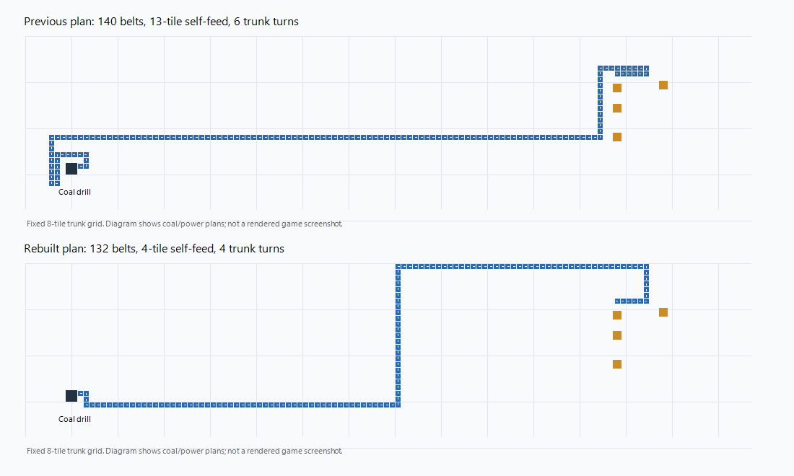

# V2: strategic model, verified execution

## Objective and rules

First goal: a real Space Age rocket launch from a new default-settings Nauvis
world. Long-term goal: the solar system edge. Use installed 2.1.20 game data,
default enemies/resources/cliffs, ordinary resource costs, engine crafting,
machine production, science consumption and launch. No research flags, material
grants or production/launch counter edits. Initial freeplay inventory is once.

Development uses the main Codex session. Evaluation uses a fresh GPT-6 Luna
medium subagent. No strong-model assistance or code edits during a scored run.

## Boundary

- Model: choose objectives, production rates, research, expansion and logistics.
- Framework: observe, calculate requirements, reserve sites/corridors, compile
  parameterized layouts, execute resource-backed jobs, prove effects, recover.
- Emergency control: deterministic fuel/defense/repair upkeep with bounded cost.
- One writer per world. Independent evaluation worlds can run separately.

The initial integration may reuse reviewed v1 transport, world catalog,
character-crafting and bootstrap executors. It must not call the v1 strategic
supervisor or treat its full-game policy as Luna's decisions. Every remaining
legacy dependency is explicit and removable.

## Job contract

Each request binds a world ID and observed tick, has an idempotency key, names a
registered capability and validates bounded typed parameters. State records
pending/running/waiting/blocked/failed/succeeded plus reason and evidence.
Success requires a live postcondition. Command acknowledgement is not success.
Partial construction persists; timeout means reconcile, never blindly repeat a
mutation. World rollback invalidates evidence and requires reconciliation.

Missing capabilities are reported as such rather than simulated or silently
substituted. Repeated identical errors and objective stalls terminate a bounded
attempt. Waiting has an expected condition and game/wall-clock deadlines.

## Production and logistics

Mining stays on patches; production districts reserve expansion and logistics
corridors before construction. Recipes and capacities come from the live game.
Ports carry item/fluid, rate, position, orientation and ownership. Belt lanes,
underground pairs, splitter priority and flow are validated. Reuse tested local
patterns before widening layout search. Preserve operating supplies while
expanding. Reserve rail corridors early; implement remote mining by midgame.

Oil coproducts, recipe alternatives and multi-output/cyclic chains require
explicit material balance; they are not forced into a single-product recipe DAG.

## PCB-style layout policy

- Place production districts and reserve logistics corridors together. Blocks
  expose fixed typed input/output ports at their boundaries, including rate and
  facing. Reserve extension footprints before funding initial construction.
- Use a shared eight-tile orthogonal trunk grid. Short local port escapes join
  whole horizontal/vertical corridors. A route currently allows at most six
  turns and 1.35 times direct distance plus four tiles for port escapes.
- A failed corridor gate is an explicit planning failure. Reconsider port,
  block position or corridor; do not fall back to a free-form maze route.
- Underground crossings are research-gated, resource-backed links with actual
  span/orientation checks. Splitters are explicit branching components with
  declared priority/rates. These broader crossing/branch executors are pending.
- Avoid interference with other item/fluid networks. Separate trunk allocation,
  local routing, construction and observed-throughput validation.
- Rank future power coast candidates using coal distance as well as access to
  the starter area. Do not choose a water-only location and ignore fuel cost.

The first live migration replaced the unfinished starter coal layout, keeping
its paid drill and existing power plant. Native preflight, ordinary guarded
hardware recovery and fresh entity checks verified a four-belt self-feed and
four-turn trunk. Whole-plan belts changed from 140 to 132; route length itself
was 128 versus 126 previously, so this is not a route-length speedup claim.
The first reserved16x16 cell now assembles finite red science to unlock logistics
naturally. Aligned electric mining banks expose collector ports and preserve
existing banks when adding capacity. These are verified development components;
automatic smelting, permanent science supply and district crossings are pending.
They must not be described as a complete PCB factory or sustained30SPM.

## Evaluation

Compare target-only, target+diagnosis and candidate-choice interfaces on paired
snapshots to measure Luna's required abstraction. Classify failures as decision,
observation, executor, missing capability or environment. Record code/model,
seed/save, settings, actions, production/consumption, game/wall time, waiting,
retry counts, interventions and tokens. Use development and unseen seeds.

Milestones: starter mining/power; construction mall and red/green science;
belt expansion and repair; oil/blue science and rail outpost; silo, real rocket
parts, platform starter pack, launch-count increase and natural platform arrival.
The initial science gate is red and green each 30/min for five game minutes.
No fixture-granted test save counts as autonomous acceptance.
